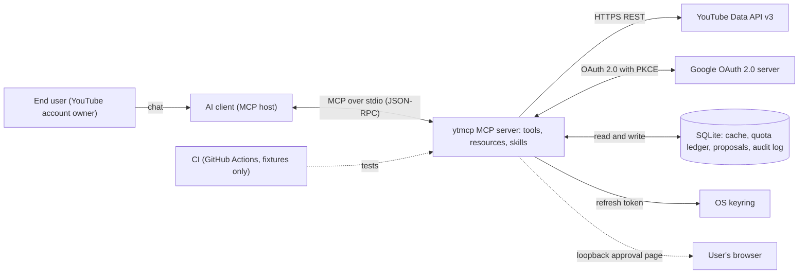
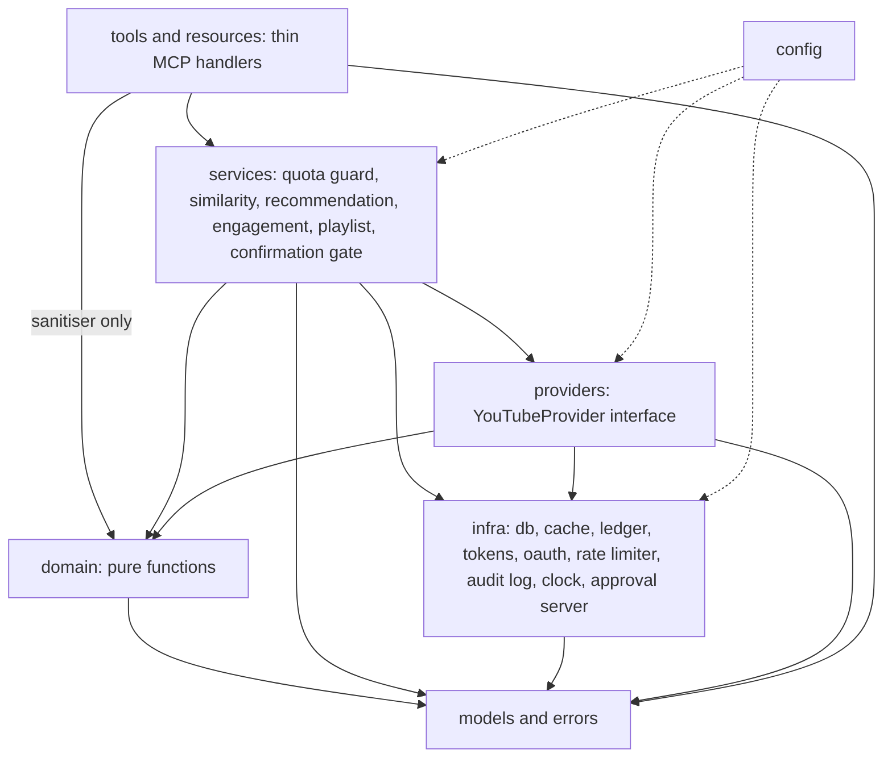
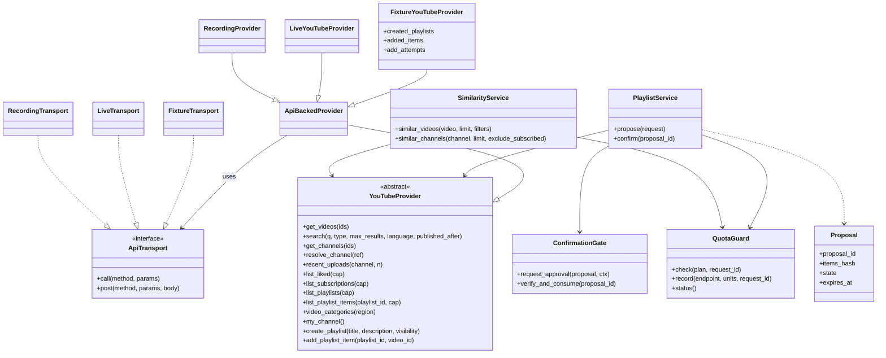
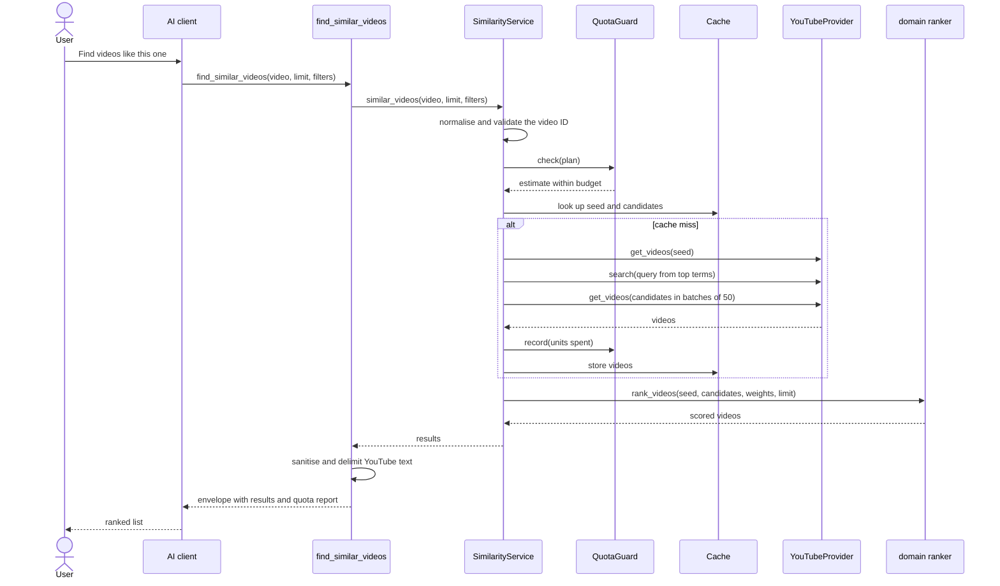
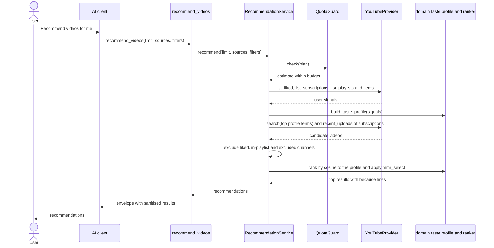
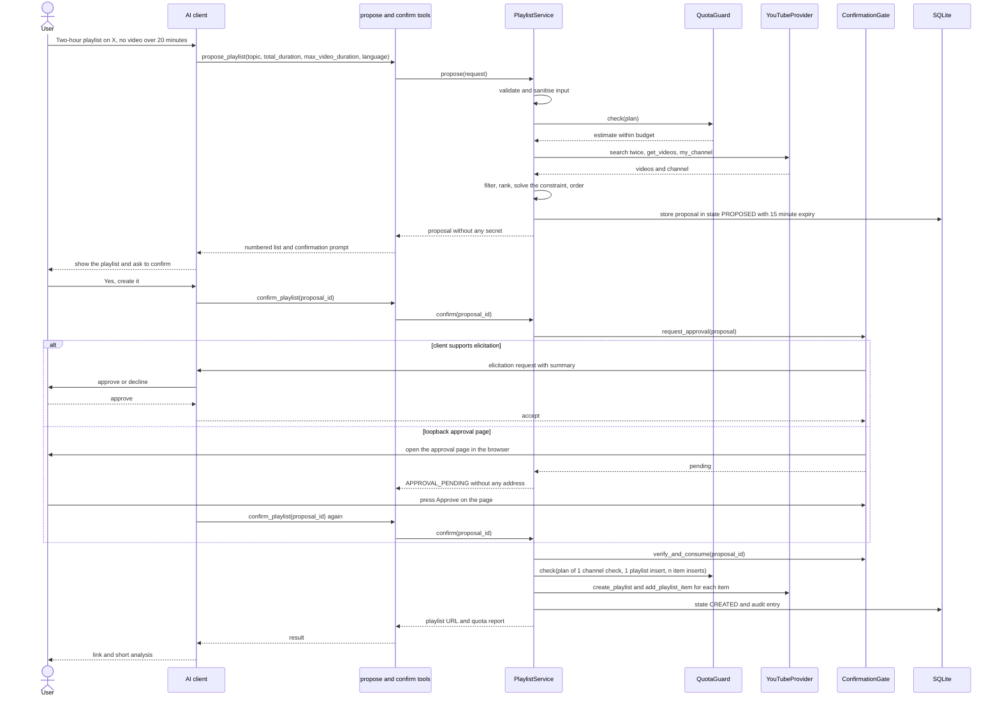
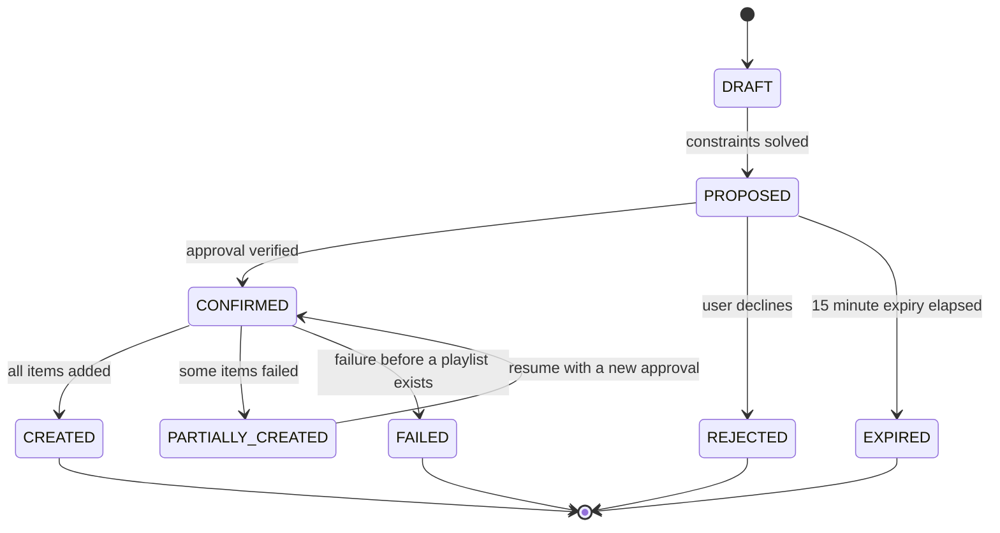
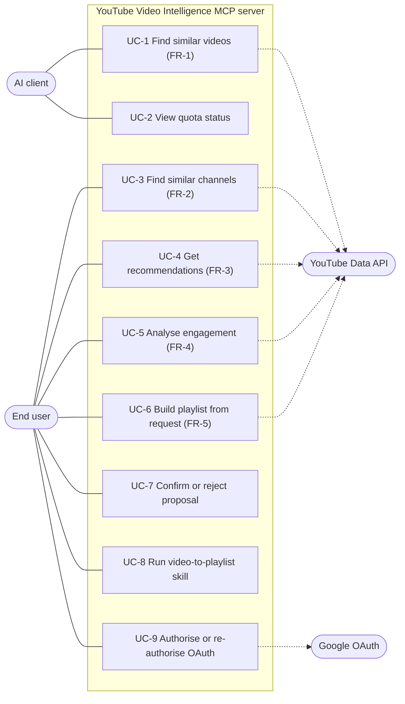
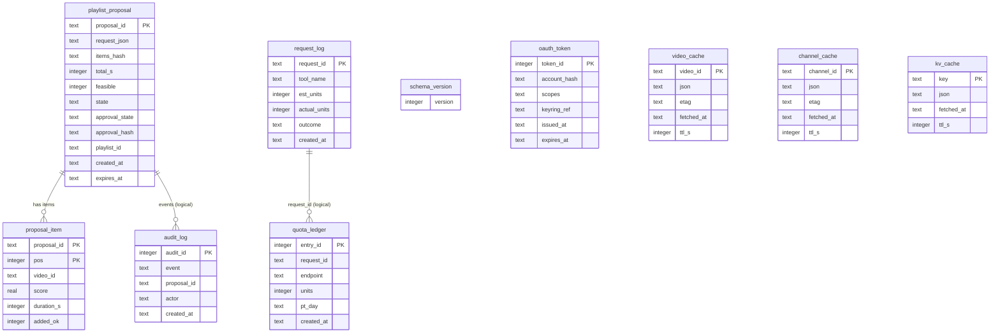
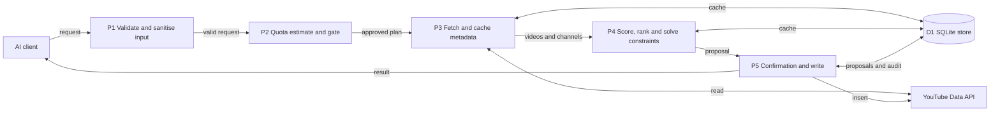

# Diagram sources

Version 1.0 (Stage 2). These Mermaid diagrams are the sources of the figures that the SRS refers to. GitHub renders them. If a diagram changes, change it here in the same commit as the design it shows.

## 1. System context

## 2. Layers

## 3. Class diagram (providers and playlist services)

## 4. Sequence: similar videos (FR-1)

## 5. Sequence: recommendations (FR-3)

## 6. Sequence: playlist creation with approval (FR-5)

## 7. Proposal state machine

## 8. Use cases

## 9. Entity-relationship diagram (local SQLite store)

## 10. Data flow (level 1)

